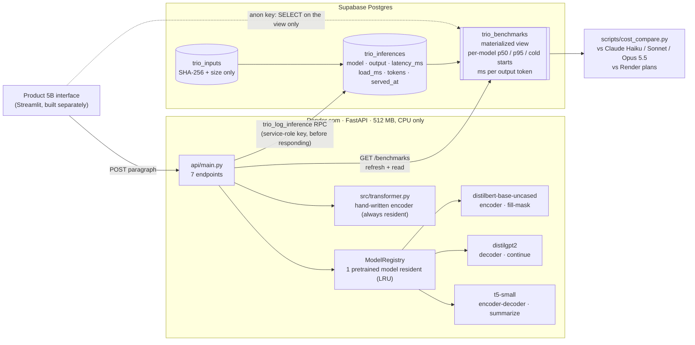
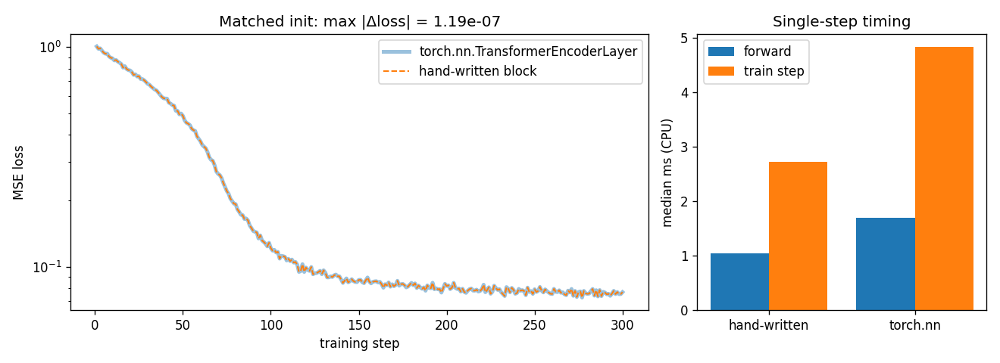

# TrioFormer: a Side-by-Side Transformer Inference Service

## Product pitch

A learning-and-development team is briefing engineering leadership on **what kind of
transformer fits which job**. They want one hosted demo that takes a paragraph and, at the
same time, (a) fills a masked word with **BERT**, (b) continues the text with **GPT-2**, and
(c) summarizes it with **T5**. They also want an honest side-by-side latency comparison to
explain the cost story, and a stored log of every comparison so they can base their internal
recommendation on real numbers. **TrioFormer is that demo and the data behind it.** It also
serves a transformer encoder written from scratch, so the teaching tab of the interface can
show what attention actually computes.

| | Link |
|---|---|
| **Render API** (interactive docs at `/docs`) | `https://<trioformer-api>.onrender.com` *(fill in from the Render dashboard)* |
| **Supabase project reference** | `<project-ref>` → `https://<project-ref>.supabase.co` *(fill in)* |
| **GitHub** | https://github.com/lukehoyle2004/CST-435-Repo/tree/main/Deep-Learning/Project-Templates/Topic_5_former-it |
| **Video walkthrough (Luke Hoyle)** | *(add link)* |
| **Engineering report (Luke Hoyle)** | [docs/ENGINEERING_REPORT.md](docs/ENGINEERING_REPORT.md) |
| **Individual contribution evidence (Luke Hoyle)** | [docs/CONTRIBUTION.md](docs/CONTRIBUTION.md) |
| **Model card** | [MODEL_CARD.md](MODEL_CARD.md) |

CST-435 / AIT-204 Topic 5, Product 5 (CLC, Halo Group D2; submitted by Luke Hoyle as the only
group member). The folder keeps the template's name, `Topic_5_former-it`; the product is
TrioFormer. The Streamlit interface is Product 5B ("TrioDeck"), built separately against this
service.

## Architecture



**How the data layer carries the cost story.** Every model call writes one row *before* the
response goes out: which checkpoint ran, how long the model computation took on the server
(`latency_ms`), how long it spent loading the checkpoint during that request (`load_ms`), and
how many tokens went in and came out. The `trio_benchmarks` materialized view aggregates
those rows per model (mean, p50, p95, warm vs cold, ms per output token).
`scripts/cost_compare.py` turns the view's numbers into cost per 1,000 calls and compares
them with frontier LLM API prices. The cost argument is built only from logged, server-side
measurements, not from anecdotes.

## The seven endpoints

| Method | Path | What it does | Logs to Supabase |
|---|---|---|---|
| POST | `/encoder_attention` | Runs the **hand-written** encoder on 2–12 words (trained to detect word-level palindromes); returns the prediction, every layer's per-head attention matrix, and per-head summary statistics | ✔ |
| POST | `/bert_fillmask` | **Encoder.** Ranks candidates for one `[MASK]` (or hides `mask_word`) | ✔ |
| POST | `/gpt2_continue` | **Decoder.** Greedy (or seeded sampling) continuation, `max_new_tokens` ≤ 80 | ✔ |
| POST | `/t5_summarize` | **Encoder-decoder.** `summarize:` with beam search (≤ 4 beams) | ✔ |
| GET | `/benchmarks` | Refreshes (throttled to once every 15 s) and reads the `trio_benchmarks` view | n/a |
| GET | `/healthz` | Always 200; reports the model loader (resident model, loads, evictions, last error, encoder block loaded) and the database client (configured, reachable, round-trip ms) | n/a |
| GET | `/version` | git SHA, Python/torch/transformers versions, and every checkpoint **pinned to a Hub commit hash** | n/a |

Every model response includes `input_sha256`, `latency_ms`, `load_ms`, `cold_start`,
`total_ms`, `input_tokens`, `output_tokens`, `checkpoint` (`name@commit`), `inference_id` and
`logged`. If Supabase is down, the answer is still returned, with `logged: false` and an
`X-Trio-Logged: false` header. The audit trail degrades loudly instead of the product going
down. Request and response schemas, with examples, are at `/docs`.

```bash
curl -X POST "$API/t5_summarize" -H "Content-Type: application/json" -d '{"text": "The city council voted on Tuesday to expand the bike lane network after a year of public meetings. Supporters said the lanes would make streets safer."}'
```

## Archetype recommendation matrix

| | Encoder (BERT) | Decoder (GPT-2) | Encoder-decoder (T5) |
|---|---|---|---|
| **Reads the input** | all at once, both directions | left to right, causal mask | all at once (encoder) |
| **Writes** | nothing new: scores positions/labels | one token at a time, appended | a new sequence, cross-attending to the input |
| **Native strength** | understanding: classify, tag, fill gaps, embed for search | open-ended generation, completion, chat | transforming one text into another: summarize, translate, rewrite |
| **Compute profile** | **one forward pass**, cost grows with input length only | one forward pass **per generated token** (KV-cached), cost grows with output length | one encoder pass + one decoder pass per output token (+ beams) |
| **Measured here** (local dry run, warm median) | ~0.27 s for 1 token | ~1.3 s for 40 tokens | ~1.4–1.6 s for ~43 tokens (2 beams) |
| **Choose it when** | the answer is a label, a span, a score or a vector | the answer is free text that continues a prompt | the answer is a rewritten version of an input |
| **Avoid it when** | you need new text | you need a faithful, bounded rewrite of an input | you need open-ended text with no source |

**When to use each archetype**

* **Encoder (BERT).** Use it when the job is to *understand* text you already have: routing
  tickets, tagging entities, scoring sentiment, or turning documents into vectors for search.
  It reads the whole input in both directions in a single pass, so it is the cheapest and
  most predictable of the three, and its cost does not depend on how long an answer is.
  It cannot write new text.
* **Decoder (GPT-2).** Use it when the deliverable is *new text* with no fixed source:
  drafting, autocomplete, conversation. Each extra output token costs another forward pass,
  so latency and cost grow with the length of the answer. Because it is trained only to
  continue text plausibly, check its output for accuracy (continuing our Tuesday council-vote
  paragraph, it says the council "voted to expand it in November").
* **Encoder-decoder (T5).** Use it when the output is a *transformation* of an input:
  summaries, translations, style rewrites. The encoder reads the source once and the decoder
  stays anchored to it through cross-attention, which keeps the output closer to the source
  than a decoder's. You pay for both stacks plus beam search.

The latency rows above come from a local dry run (`docs/benchmarks/latency_local.json`).
The figures quoted in the engineering report come from the **Supabase `trio_benchmarks`
view** after `scripts/benchmark_latency.py` is run against the deployed service.

## The hand-written transformer (`src/transformer.py`)

Scaled-dot-product attention, multi-head attention, sinusoidal positional encoding and a full
pre-norm encoder block (attention + MLP + residuals), all typed, documented, and annotated with
shapes:

| Step | Shape |
|---|---|
| input `x` | `[B, T, D]` |
| fused projection `x W_QKV` → split → heads | `3 × [B, H, T, d_h]`, `d_h = D/H` |
| scores `Q Kᵀ / √d_h`, softmax over keys | `[B, H, T, T]` (each row sums to 1) |
| `weights · V`, concat heads, `W_O` | `[B, H, T, d_h]` → `[B, T, D]` → `[B, T, D]` |
| `h = x + MHA(LN₁(x))`; `out = h + W₂·ReLU(W₁·LN₂(h))` | `[B, T, D]` (MLP width `F`) |

**Unit tests** (`tests/test_transformer.py`, 19 tests): output shape equals input shape;
attention weights sum to 1 over keys (padding gets exactly 0); gradients reach every parameter
and the input; the block is permutation-equivariant, and an encoder is equivariant **only
without** positional encoding. They also check closed-form values, `F.scaled_dot_product_attention`,
`nn.MultiheadAttention` and `nn.TransformerEncoderLayer` outputs, and train/eval dropout behavior.

**Benchmark vs `torch.nn.TransformerEncoderLayer`** (`scripts/benchmark_block.py`). The
hand-written block's parameters are copied into `nn.TransformerEncoderLayer(norm_first=True)`
(matched initialization), and both train on identical synthetic batches with identically
seeded Adam: **the loss curves agree to 1.2 × 10⁻⁷ over 300 steps** (final MSE 0.076678 for
both). Single-step timing on one CPU thread (D = 64, 4 heads, T = 16, batch 32): forward
1.04 ms vs 1.70 ms, train step 2.72 ms vs 4.83 ms. The hand-written block is faster at this
toy size because `nn.MultiheadAttention`'s general-purpose path does extra argument
checking and reshaping. That is per-call overhead, not better math, and it would not last at
realistic sizes or on a GPU, where torch's fused kernels win.



**Why the toy task.** Random weights would draw noise, so `/encoder_attention` serves a
2-layer, 4-head encoder (built only from this module, 17k parameters) trained offline to decide
whether a sequence of words is a palindrome ("dog bites man bites dog"). It reaches 95.7%
held-out accuracy (100% up to length 4, 90.6% at length 12). The heads did **not** learn a
clean anti-diagonal: their weight on the mirror position is close to uniform. The endpoint
therefore returns per-head `mirror` / `self` / `same_word` mass next to the uniform baseline
instead of claiming a pattern that isn't there. This repeats the Seq-Sight lesson that
attention weights are not an explanation.

## Data persisted / not persisted

| Persisted (Supabase) | Not persisted anywhere |
|---|---|
| `trio_inputs`: SHA-256 of the stripped input, character and word counts, times submitted, first/last seen | the submitted paragraph or words |
| `trio_inferences`: model, archetype, `checkpoint@commit`, task, the model's **output**, `latency_ms`, `load_ms`, `cold_start`, token counts, `source` (`api`/`benchmark`/`test`), git SHA, `served_at` | BERT's filled-in paragraph (only the ranked candidate words are stored) |
| `trio_benchmarks`: per-model aggregates only | the attention matrices returned by `/encoder_attention` (only the prediction + confidence) |
| | IP addresses, user agents, accounts, cookies (the API has none) |

### Privacy statement

TrioFormer never stores what you type. A paragraph is reduced to its SHA-256 hash and its
size. The hash links the four model calls on the same paragraph without revealing the
paragraph, and it can only be matched by someone who already has the exact text. What *is*
stored is what the models produced, because auditing a model service means being able to see
what it said. That has a consequence we state plainly: **a summary or a continuation can
repeat words from the input** (T5 often copies whole clauses). Do not submit text you are not
willing to have echoed into the log. Outputs are truncated at 1,000 characters. The raw tables
are protected by row-level security: the public anon key (used by Product 5B interfaces) can
read **only** the aggregate `trio_benchmarks` view, not the hashes and not the outputs. Writes
go through a `SECURITY INVOKER` function that only the server-side service role may execute.
`tests/test_api.py::test_raw_text_is_never_stored` and `tests/test_migration.py` enforce this.

## Run locally

```bash
py -3.12 -m venv .venv
```

```bash
.venv/Scripts/python -m pip install -r requirements-dev.txt
```

```bash
.venv/Scripts/python -m uvicorn api.main:app --reload --port 8000
```

Then open http://127.0.0.1:8000/docs. Without a `.env` the service runs and every response
says `logged: false`. Copy `.env.example` to `.env` and fill in the Supabase URL and keys to
log for real. The first call to each model downloads its pinned checkpoint (~1 GB total).

## Deploy

1. **Supabase.** Create a project, open *SQL Editor*, paste and run
   [`db/migrations/001_init.sql`](db/migrations/001_init.sql). Copy the project URL and the
   legacy `eyJ…` service-role and anon keys (*Project Settings → API*).
2. **Render.** *New → Blueprint* → this repo. [`render.yaml`](render.yaml) builds with CPU-only
   torch, prefetches the three pinned checkpoints into `.hf_cache` during the build, and starts
   `uvicorn`. Set `SUPABASE_URL` and `SUPABASE_SERVICE_KEY` in the service's environment. Read
   the real service URL from the dashboard (Render service names are global).
3. **Verify.** `GET /healthz` should report `"status": "ok"` with `database.ok: true`. Then run
   `pytest tests/test_supabase_roundtrip.py` locally with the same keys in `.env` to prove the
   access rules (service role can write and refresh; anon can read only the view).
4. **Collect the evidence.**
   `python -m scripts.benchmark_latency --base-url https://<api>.onrender.com --rounds 5`, then
   `python -m scripts.cost_compare docs/benchmarks/latency_render.json`.

Memory: on Render's free instance (512 MB, 0.1 CPU) only one pretrained checkpoint is kept in
memory at a time (`TRIO_MAX_RESIDENT=1`). Measured locally, torch + transformers take ~190 MB,
and each fp32 checkpoint peaks at 550–600 MB RSS during its first inference on Windows
(`docs/benchmarks/memory_float32.json`). `TRIO_DTYPE=bfloat16` keeps the peak near 430 MB but
is 5–10× slower on CPU (`memory_bfloat16.json`). Dynamic int8 quantization was tried and
rejected: it broke GPT-2's output ("the the the …") and cut BERT's top-1 probability from
0.88 to 0.12.

## Tests and CI

```bash
.venv/Scripts/python -m pytest -q
```

78 tests (4 skip without live Supabase credentials). They cover the hand-written block,
the toy encoder and the matched-init benchmark, the migration's privacy and access rules,
all seven endpoints on the real pinned checkpoints, logging before responding, one input
row per paragraph across models, raw text never reaching storage, cold-start accounting, a
**Supabase outage** (answers still served with `logged: false`, `/benchmarks` 503, `/healthz`
degraded), a checkpoint that fails to load and then recovers, and a regression fixture
(`tests/fixtures/reference_outputs.json`). The [TrioFormer tests](../../../.github/workflows/trioformer-tests.yml)
workflow runs the suite on every push that touches this folder, with the checkpoints cached
between runs.

## Repository map

```
api/main.py            FastAPI app: the seven endpoints, logging before responding
api/db.py              Supabase access (service-role key, RPCs) -- swapped by FakeDB in tests
src/transformer.py     hand-written SDPA, MHA, positional encoding, encoder block, encoder stack
src/toy.py             palindrome task + classifier served by /encoder_attention
src/pipelines.py       BERT / GPT-2 / T5 loading (pinned), LRU registry, inference + timing
shared/schemas.py      request/response models (the public contract)
db/migrations/         001_init.sql: tables, materialized view, RPCs, RLS
scripts/               benchmark_block, train_toy_encoder, measure_memory, prefetch_models,
                       benchmark_latency, cost_compare, make_reference
docs/                  engineering report, contribution evidence, benchmark outputs
```

## Individual contribution (Luke Hoyle)

Sole member of Halo Group D2, so every task was mine. The full evidence (key points and the
complete task list) is in [docs/CONTRIBUTION.md](docs/CONTRIBUTION.md).
