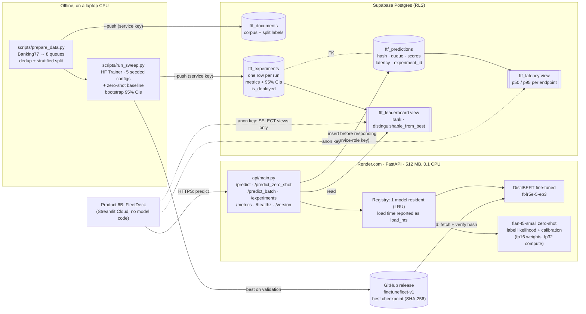

# FineTuneFleet: a Fine-Tuned Support-Message Router as a Service

## Product pitch

A digital bank's support desk has **eight teams** (card services, transfers, top-ups, cash &
ATM, fees & FX, payments & disputes, security & fraud, account & identity). Today a person reads
every incoming message to decide which team gets it. **FineTuneFleet routes each message
automatically** with a small model fine-tuned on about 9,000 labelled examples. It flags the
messages it is unsure about, or that might be fraud, for a person. It runs on a free CPU server
for a fraction of a cent per thousand messages, never stores what customers write, and keeps a
record of every experiment and every prediction. The bank can always ask *which model said
that, and how good was it?*

The service serves a **zero-shot baseline** next to the fine-tuned model, so the case for fine-tuning is
made with numbers, not asserted: on 3,076 held-out messages the fine-tuned router reaches
**macro-F1 0.965** against **0.669**. The gain is **+0.296, with a 95% interval of +0.279 to +0.315**.

| | Link |
|---|---|
| **Render API** (interactive docs at `/docs`) | https://finetunefleet-api.onrender.com (docs: https://finetunefleet-api.onrender.com/docs) |
| **Supabase project reference** | `rtlxnyiyoyxvmqhvhcdf` (project `finetunefleet`) → https://rtlxnyiyoyxvmqhvhcdf.supabase.co |
| **GitHub** | https://github.com/lukehoyle2004/CST-435-Repo/tree/main/Deep-Learning/Project-Templates/Topic_6_fine-it |
| **Interface (Product 6B, FleetDeck)** | _Streamlit URL: added after deployment_ ([source](../Topic_6B_fleet-deck)) |
| **Video walkthrough (Luke Hoyle)** | _added after recording_ |
| **Model weights** | GitHub release [`finetunefleet-v1`](https://github.com/lukehoyle2004/CST-435-Repo/releases/tag/finetunefleet-v1) |
| **Model card / dataset card** | [MODEL_CARD.md](MODEL_CARD.md) · [docs/DATASET_CARD.md](docs/DATASET_CARD.md) |
| **Pre-training objectives comparison** | [docs/PRETRAINING_OBJECTIVES.md](docs/PRETRAINING_OBJECTIVES.md) |
| **Engineering report, ethics and worldview reflection** | [docs/ENGINEERING_REPORT.md](docs/ENGINEERING_REPORT.md) |
| **Individual contribution evidence (Luke Hoyle)** | [docs/CONTRIBUTION.md](docs/CONTRIBUTION.md) |

CST-435 / AIT-204 Topic 6, Product 6 (CLC, Halo Group D2; submitted by Luke Hoyle as the only
group member). The folder keeps the template's name, `Topic_6_fine-it`; the product is
FineTuneFleet. The Streamlit dashboard is Product 6B ("FleetDeck"), built separately against
this service.

## Architecture



**What runs where.**
* **Offline (laptop CPU):** the corpus is built and every experiment is trained.
* **Supabase:** the corpus, one row per experiment (with confidence intervals), and one row per
  prediction. Each prediction row is joined by foreign key to the experiment row of the model
  that produced it.
* **Render:** serves the best checkpoint. At build time it downloads the checkpoint from the
  GitHub release and refuses it unless its SHA-256 equals the deployed row's `artifact_sha256`.
  The service can therefore serve only the exact model the leaderboard says is deployed.
* **FleetDeck:** talks to the API over HTTPS and reads two views with the public anon key.
  Row-level security stops that key from reading the corpus or a single prediction.

## Endpoints

| Method | Path | What it does | Logs to `ftf_predictions` |
|---|---|---|---|
| POST | `/predict` | Routes one message (1–2,000 characters) with the **deployed fine-tuned** DistilBERT | ✔ |
| POST | `/predict_zero_shot` | Routes the same message with the **zero-shot** flan-t5-small baseline | ✔ |
| POST | `/predict_batch` | Up to 32 messages through either model (used by the cost benchmark; rows tagged `source='benchmark'`) | ✔ |
| GET | `/experiments` | The leaderboard from Supabase: every run with its CIs, `deployed_run`, `best_run`, and whether the deployed run is the best | n/a |
| GET | `/metrics` | Calls, errors, unlogged predictions and mean latency since start; all-time p50/p95 per endpoint from `ftf_latency` | n/a |
| GET | `/queues` | The eight queues and what each owns | n/a |
| GET | `/healthz` | Database reachability and round-trip time; resident models and the last load error | n/a |
| GET | `/version` | Git SHA; Python, torch and transformers versions; the deployed run, its weights hash and the pinned zero-shot checkpoint | n/a |

Every prediction returns `queue`, `confidence`, `needs_review`, all eight `scores`, `run_name`,
`experiment_id`, `checkpoint`, `latency_ms` (model compute), `load_ms` and `cold_start`,
`n_tokens`, `prediction_id`, and `logged`. **Needs review** is true when the model is under 60%
confident, or when the fraud queue has at least a 10% chance without winning.

If Supabase is down, routing keeps working, and the problem stays visible:
* each answer comes back with `logged: false` and an `X-FTF-Logged: false` header;
* `/experiments` returns 503 rather than stale numbers;
* `/healthz` reports `degraded`.

```bash
curl -X POST "https://finetunefleet-api.onrender.com/predict" -H "Content-Type: application/json" -d '{"text": "Someone used my card without my permission."}'
```

## Data: the corpus in the database

[Banking77](https://huggingface.co/datasets/PolyAI/banking77) (CC-BY-4.0, pinned revision) has
77 intents, which [`shared/queues.py`](shared/queues.py) maps to 8 queues by three written rules:
1. unauthorised activity, or a lost or stolen card or phone → security & fraud;
2. any fee or exchange-rate question → fees & FX;
3. otherwise, the team that owns the product.

[`scripts/prepare_data.py`](scripts/prepare_data.py) is the reproducible loader:
* deduplicates within and **across** splits (it dropped 25 training messages that also appear
  in test);
* stratifies a validation split by intent;
* writes `data/corpus.csv`;
* with `--push`, upserts 13,023 rows into `ftf_documents`, each labelled `train` (8,952),
  `validation` (995) or `test` (3,076).

See the [dataset card](docs/DATASET_CARD.md).

## Experiments: five seeded configurations and a zero-shot baseline

[`scripts/run_sweep.py`](scripts/run_sweep.py) trains every configuration in
[`configs/sweep.yaml`](configs/sweep.yaml) with the Hugging Face `Trainer`
([`src/finetune.py`](src/finetune.py)). Each run uses seed 42, evaluates and saves every epoch,
and keeps the epoch with the best **validation** macro-F1. The test split is scored once
afterwards, with 2,000-resample bootstrap intervals; "Δ vs zero-shot" is a **paired** bootstrap
on the same resamples ([`src/metrics.py`](src/metrics.py)). Each run is one row in
`ftf_experiments`, and the run with the best validation score is deployed.

<!-- from docs/experiments/sweep_table.md -->
| Rank | Run | LR | Epochs | Train msgs | Encoder | Val macro-F1 | Test macro-F1 [95% CI] | Δ vs zero-shot [95% CI] | Test accuracy | Fraud recall [95% CI] | Train time | ms/msg |
|---:|---|---:|---:|---:|---|---:|---|---|---:|---|---:|---:|
| 1 | **ft-lr5e-5-ep3** (deployed) | 5e-05 | 3 | 8,952 | trained | 0.970 | 0.965 [0.958, 0.972] | +0.296 [+0.279, +0.315] | 0.968 | 0.971 [0.948, 0.991] | 38.8 min | 46.8 |
| 2 | ft-lr2e-5-ep3 | 2e-05 | 3 | 8,952 | trained | 0.958 | 0.954 [0.946, 0.962] | +0.285 [+0.267, +0.304] | 0.959 | 0.929 [0.893, 0.959] | 39.5 min | 44.1 |
| 3 | ft-lr5e-5-ep1 | 5e-05 | 1 | 8,952 | trained | 0.941 | 0.933 [0.923, 0.942] | +0.264 [+0.246, +0.283] | 0.940 | 0.887 [0.845, 0.924] | 12.5 min | 40.4 |
| 4 | head-only-lr1e-3-ep3 | 0.001 | 3 | 8,952 | frozen | 0.804 | 0.807 [0.791, 0.822] | +0.139 [+0.118, +0.160] | 0.822 | 0.717 [0.660, 0.775] | 15.8 min | 48.2 |
| 5 | ft-lr5e-5-ep3-n1000 | 5e-05 | 3 | 998 | trained | 0.807 | 0.804 [0.787, 0.820] | +0.136 [+0.115, +0.156] | 0.839 | 0.350 [0.291, 0.415] | 8.1 min | 41.4 |
| 6 | zero-shot-flan-t5-small | -- | -- | 0 | zero-shot | 0.667 | 0.669 [0.649, 0.686] | -- | 0.690 | 0.604 [0.543, 0.661] | -- | 605.7 |

*ms/msg: batched inference on a laptop CPU. Training times are on the same laptop.*

**What the sweep shows.**
* **Fine-tuning the whole encoder matters.** Freezing DistilBERT and training only the head
  (row 4) loses 0.16 macro-F1. Masked-LM features are good, but they are not already arranged
  into the bank's eight queues.
* **Labels matter more than epochs.** With 1,000 training messages instead of 8,952 (row 5),
  macro-F1 falls 0.16. Fraud recall collapses from 0.97 to **0.35**, because fraud is a small
  queue and the few examples were not enough.
* **The top two are not meaningfully different on macro-F1.** Their intervals overlap, so the
  learning-rate choice could be luck, which the leaderboard view flags. They do differ on fraud
  recall (0.971 vs 0.929).
* **One epoch gets most of the way** (0.933 in 12.5 minutes).

Trainer logs for every run (loss every 25 steps, evaluation every epoch) are in
[`docs/experiments/trainer_logs/`](docs/experiments/trainer_logs).

### The zero-shot baseline, made fair

A weak baseline would make the fine-tuning gain look bigger than it is, so the zero-shot model
([`src/zero_shot.py`](src/zero_shot.py)) was given every reasonable advantage:
* **It cannot produce an invalid answer.** Each of the eight queue labels is scored by its
  length-normalized log-likelihood after the instruction, rather than generated.
* **Its label bias is removed.** Uncalibrated, flan-t5-small sent **all 995 validation
  messages to one queue** (macro-F1 0.02 with one prompt). The fix is *contextual calibration*:
  divide by the probabilities it gives on content-free inputs such as "N/A".
* **Its prompt was chosen fairly.** Three prompts × {raw, calibrated} were scored on the
  validation split, and the best was picked without looking at test (options/calibrated:
  0.667; [`zero_shot_prompt_selection.json`](docs/experiments/zero_shot_prompt_selection.json)).

It still loses by 0.30 macro-F1 and is 13× slower per message. When zero-shot prompting *would*
be the right choice is set out in
[docs/PRETRAINING_OBJECTIVES.md](docs/PRETRAINING_OBJECTIVES.md#when-zero-shot-prompting-beats-fine-tuning-an-honest-list).

## Cost and quality, with numbers

Measured on the live Render service (0.1 CPU, 512 MB) by
`python -m scripts.benchmark_latency`. Full output:
[`docs/benchmarks/latency_render.json`](docs/benchmarks/latency_render.json) and
[`docs/benchmarks/cost_comparison.md`](docs/benchmarks/cost_comparison.md).

| | Fine-tuned DistilBERT | Zero-shot flan-t5-small |
|---|---:|---:|
| **Test macro-F1 [95% CI]** | **0.965** [0.958, 0.972] | 0.669 [0.649, 0.686] |
| Server model time per message, batch of 16 (p50) | **155 ms** | 4,357 ms |
| Single call, warm: server model time (p50) | 192 ms | 5,034 ms |
| Single call, warm: end-to-end from a laptop (p50) | 1,664 ms | 6,304 ms |
| Load when switching to it (one model resident) | 0.4 s | 14.8 s |

**Monthly cost for the same routing job.** Frontier prices are Anthropic list prices as of
2026-11-18. Each frontier call sends a ~220-token instruction plus the message and returns ~6
tokens. Self-hosted capacity comes from the measured 155 ms per message.

| Option | 10k msgs | 100k | 1M | 10M |
|---|---:|---:|---:|---:|
| **Self-hosted, Render Free** (sleeps when idle) | $0 | $0 | $0 | $0 |
| **Self-hosted, Render Starter** (always on, ~85M msgs/month capacity) | $7 | $7 | $7 | $7 |
| Claude Haiku 5.5 API | $0.26 | $2.6 | $26 | $263 |
| Claude Sonnet 5.5 API | $5 | $53 | $525 | $5,252 |
| Claude Opus 5.5 API | $31 | $305 | $3,050 | $30,504 |

**Is it cheaper, faster and good enough?**
* **Cheaper only above about 270,000 messages a month.** An always-on Starter instance costs
  $7 a month at any volume. Claude Haiku 5.5, the cheapest frontier option, costs $26 at 1M
  messages and $263 at 10M. Below about 270k messages a month (roughly 9,000 a day), Haiku
  costs *less* than the $7 instance. Neither column includes the engineering time behind the
  fine-tuned pipeline, which is the larger cost for a small bank.
* **Faster per message.** 155–192 ms of model time on a tenth of a CPU, with no network hop to a
  third party. The rest of the 1.7 s end-to-end time is outside the model: the round trip from
  a laptop to Render, Render's proxy, and the Supabase insert that runs before every response.
  This benchmark does not break those three down separately.
* **Good enough, measured.** 0.965 macro-F1 and 0.971 fraud recall on held-out data, against 0.669
  for the zero-shot model on the same server. Frontier *quality* was not measured, so whether
  Haiku would match it is an open question, not a claim.
* **Privacy decides it for a bank.** Self-hosting means customer messages never leave the
  bank's own infrastructure. A frontier API means sending every message to a third party.

The free instance sleeps after 15 idle minutes, and waking takes about a minute. The one-model
memory limit also makes the first call after switching endpoints slow (14.8 s for zero-shot).
Both are reported, not hidden: `load_ms` and `cold_start` are in every response and in
`ftf_predictions`.

## Data persisted / not persisted

| Persisted (Supabase) | Not persisted anywhere |
|---|---|
| `ftf_documents`: the public Banking77 training corpus with split labels and hashes | any message sent to the live API |
| `ftf_experiments`: hyperparameters, seed, validation and test metrics with 95% CIs, per-queue precision/recall/F1, training time, weights SHA-256, which run is deployed | model weights (they live in the GitHub release, identified by hash) |
| `ftf_predictions`: SHA-256 of the cleaned message, its character and token counts, the queue, confidence, `needs_review`, all eight scores, `latency_ms`, `load_ms`, `cold_start`, endpoint, `source` (`api`/`benchmark`/`test`), API version, timestamp, and the `experiment_id` that served it | IP addresses, user agents, accounts, cookies (the API has none) |
| `ftf_leaderboard`, `ftf_latency`: views over the above | |

### Privacy statement

**FineTuneFleet never stores what a customer writes.** A message is reduced to its SHA-256 hash
and its length before anything is written. The hash lets the bank tell that the same message was
routed twice. It cannot be reversed, and only someone who already has the exact text can match
it. What *is* stored is what the model decided, its confidence and every queue's probability,
because auditing a router means being able to ask what it said and why it was trusted.

Row-level security enforces the boundary. The public anon key, the only key FleetDeck holds,
can read the experiment leaderboard and the latency aggregates. Postgres refuses it
`ftf_predictions` and `ftf_documents` ("permission denied"). Only the server-side service-role
key, held in Render's environment and never in the interface, can write. Three tests enforce
this:
* `tests/test_api.py::test_predict_logs_a_hash_joined_to_the_deployed_experiment` (the logged
  row holds the hash, and the message text appears nowhere in it)
* `tests/test_migration.py`
* the live `tests/test_supabase_roundtrip.py::test_anon_key_reads_aggregates_but_not_text_or_predictions`

## Run locally

```bash
py -3.13 -m venv .venv
```

```bash
.venv/Scripts/python -m pip install -r requirements-dev.txt
```

```bash
.venv/Scripts/python -m scripts.prepare_data
```

```bash
.venv/Scripts/python -m scripts.fetch_model
```

```bash
.venv/Scripts/python -m uvicorn api.main:app --reload --port 8000
```

Then open http://127.0.0.1:8000/docs. `fetch_model` needs `FTF_MODEL_URL` (it is in
`.env.example`). To retrain instead, run `python -m scripts.run_sweep --pick-prompt`, then
`python -m scripts.run_sweep`; this takes about two hours on a laptop CPU. Without a `.env` the
API still answers, with `logged: false`.

## Deploy

1. **Supabase.** Create a project and run [`db/migrations/001_init.sql`](db/migrations/001_init.sql)
   in the SQL editor. Put the URL and the legacy `eyJ…` service-role and anon keys in `.env`, then
   run `python -m scripts.prepare_data --push` and `python -m scripts.run_sweep --push`. The second
   command uploads `results.json` and does not retrain.
2. **Weights.** Publish `models/deployed` as a `.tar.gz` GitHub release asset
   (`finetunefleet-v1`).
3. **Render.** *New → Blueprint* → this repo, Blueprint path
   `Deep-Learning/Project-Templates/Topic_6_fine-it/render.yaml`. The build installs CPU-only
   torch, fetches and hash-checks the checkpoint, and caches flan-t5-small plus its float16 copy.
   Enter `SUPABASE_URL` and `SUPABASE_SERVICE_KEY` when asked.
4. **Verify.** `GET /healthz` should report `"status": "ok"`. Then run
   `pytest tests/test_supabase_roundtrip.py` with the same `.env`.

**Memory.** The first deploy ran out of memory (over 512 MB) on its first zero-shot call, with
both models resident. Now **one model is resident at a time** (`FTF_MAX_RESIDENT=1`), so
switching endpoints costs a cold start, reported as `load_ms`. flan-t5-small also keeps its
weights in **float16 while computing in float32**, which halves its ~300 MB of weights. That
variant agrees with the float32 baseline on **all 3,076 test messages**
([`zero_shot_served_variant.json`](docs/experiments/zero_shot_served_variant.json)). Two
alternatives were measured and rejected:
* **bfloat16** was 10× slower on CPU;
* **int8 dynamic quantization** cut agreement with the baseline to 13–30%. T5 is known to be
  fragile under int8.

## Tests and CI

```bash
.venv/Scripts/python -m pytest -q
```

56 tests; the five live Supabase tests skip without a `.env`.

| File | What it proves |
|---|---|
| `test_data.py` | the mapping covers all 77 intents; split sizes; no message in two splits; every intent in every split |
| `test_metrics.py` | bootstrap CIs bracket the estimate, are deterministic and narrow with n; the paired Δ; the fast macro-F1 equals scikit-learn's |
| `test_api.py` | the schema of every endpoint; every prediction logged and joined to its experiment; text never stored; cold → warm accounting; batch; validation (422); leaderboard order and CIs; deployed-is-best |
| `test_outage.py` | Supabase down: routing still answers with `logged: false`; `/experiments` 503 without leaking internals; `/healthz` degraded; a failed model load returns 503 and then recovers; a missing checkpoint |
| `test_behavior.py` | **beats the baseline** beyond the paired CI; fraud recall; selection on validation; a 24-message **regression fixture**; casing, spacing and punctuation don't change the queue; the served zero-shot variant matches the leaderboard |
| `test_migration.py` | `ftf_` prefixes; hashes, not text; the foreign-key join; CI columns; one deployed row; anon limited to the views |
| `test_supabase_roundtrip.py` | live: corpus and experiments loaded; a prediction written, joined and deleted; Postgres rejects invariant-breaking rows; anon refused |
| `test_finetune.py` | two seeded training runs give identical predictions and keep the label contract |

The [FineTuneFleet tests](../../../.github/workflows/finetunefleet-tests.yml) workflow runs the
suite on every push that touches this folder. It downloads the release checkpoint, verifies its
hash exactly as the Render build does, and caches it.

## Repository map

```
api/main.py              FastAPI: 8 endpoints; log before responding; outage degradation
api/db.py                Supabase access (service-role key); swapped for FakeDB in tests
src/finetune.py          HF Trainer fine-tuning, one Config = one experiment row
src/zero_shot.py         flan-t5-small label-likelihood router + contextual calibration
src/metrics.py           macro-F1, fraud recall, bootstrap CIs, paired delta
src/serving.py           model loading, LRU registry, review policy
shared/                  queue contract, pinned checkpoints, schemas, text hashing
db/migrations/           001_init.sql: tables, views, RLS, grants
configs/sweep.yaml       the five configurations
scripts/                 prepare_data, run_sweep, fetch_model, eval_served_zero_shot, benchmark_latency
docs/                    reports, cards, experiment outputs, trainer logs, benchmarks
```

## Individual contribution (Luke Hoyle)

Sole member of Halo Group D2, so every task was mine. The full evidence is in
[docs/CONTRIBUTION.md](docs/CONTRIBUTION.md).
